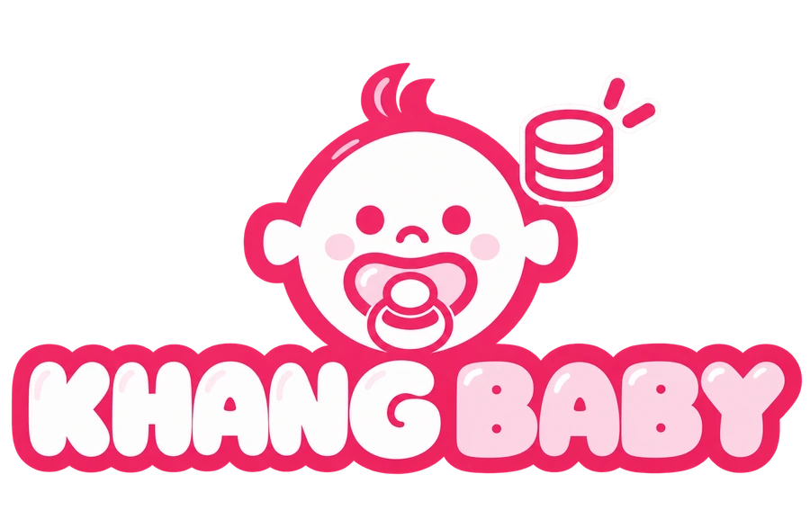

<p align="center">
  
</p>

<h1 align="center">SellerKhangBaby LIVE KPI</h1>

<p align="center">
  Dashboard nội bộ theo dõi GMV, đối soát TikTok LIVE và tính KPI nhân sự cho Khang Baby.
</p>

<p align="center">
  <a href="https://sellerkhangbaby-live-kpi.sellerhunghienhoa.workers.dev">
    
  </a>
  <a href="https://github.com/sellerhunghienhoa/sellerkhangbaby/releases">
    
  </a>
  <a href="https://github.com/sellerhunghienhoa/sellerkhangbaby/actions/workflows/release-backup.yml">
    
  </a>
</p>

<p align="center">
  <a href="https://sellerkhangbaby-live-kpi.sellerhunghienhoa.workers.dev"><strong>Mở website</strong></a>
  · <a href="https://github.com/sellerhunghienhoa/sellerkhangbaby/releases">Bản phát hành</a>
  · <a href="./docs/API_SETUP.md">Cấu hình API</a>
  · <a href="./docs/STORAGE_USAGE.md">Cấu hình dung lượng</a>
</p>

---

## Tổng quan

SellerKhangBaby LIVE KPI gom dữ liệu từ TikTok Shop Seller và TikTok Creator vào một quy trình thống nhất:

- Theo dõi GMV LIVE Seller và GMV Affiliate của `shopkhangbaby`, `mekhangsua`.
- Đồng bộ phiên LIVE, đơn hàng, hoàn/hủy và đơn ngoài LIVE.
- Đối soát GMV sau khi phiên kết thúc và khách đã nhận hàng.
- Phân công Host/Operator, tính hoa hồng và KPI nhân sự.
- Xuất báo cáo phục vụ kiểm tra, đối soát và chốt lương.

## Tính năng chính

| Khu vực | Công dụng |
|---|---|
| **Tổng quan** | Tách rõ tổng GMV, LIVE Seller, Affiliate, GMV chưa chốt và GMV đã đối soát |
| **Phiên LIVE** | Đồng bộ phiên, thời lượng LIVE, Host/Operator và trạng thái đối soát |
| **Đơn hàng** | Phân biệt đơn LIVE, đơn ngoài LIVE, đơn đang giao, hủy và hoàn trả |
| **KPI nhân sự** | Tổng hợp GMV đã chốt, giờ LIVE của Host và hoa hồng theo vai trò |
| **TikTok / API** | Quản lý kết nối Seller và hai Creator, tự làm mới token và đồng bộ dữ liệu |
| **Lưu trữ** | Theo dõi dung lượng GitHub, Firebase, Cloudflare và chính sách chống tràn |

## Quy tắc số liệu

### GMV

```text
Tổng GMV = GMV LIVE Seller + GMV Affiliate
```

- **GMV LIVE Seller**: doanh số LIVE lấy từ TikTok Shop Seller.
- **GMV Affiliate**: doanh số Affiliate lấy bằng token Creator của từng kênh.
- **GMV ngoài LIVE**: theo dõi riêng và không tính vào KPI LIVE.
- Phiên đang LIVE hoặc còn đơn chưa nhận hàng luôn nằm trong **GMV chưa chốt**.

### Điều kiện chốt KPI

Một phiên chỉ được tính vào **GMV đã giao & đối soát** khi:

1. Phiên LIVE đã kết thúc.
2. Đơn hàng khớp đúng Shop và LIVE ID.
3. Dữ liệu đơn/hoàn đã đồng bộ đầy đủ.
4. Không còn đơn đang chờ khách nhận.

```text
KPI Host     = GMV đã đối soát × 0,3%
KPI Operator = GMV đã đối soát × 0,1%
```

Campaign và Mega LIVE dùng KPI thủ công để tránh cộng trùng với KPI tự động.

## Phân quyền

| Vai trò | Quyền chính |
|---|---|
| **Admin** | Quản trị toàn bộ dữ liệu, tài khoản, API và dung lượng |
| **Host** | Xem dữ liệu được phân công, KPI cá nhân, giờ LIVE và báo cáo được phép |
| **Operator** | Xem dữ liệu được phân công và KPI cá nhân, không tính giờ LIVE |
| **Chờ duyệt** | Chỉ xem trạng thái tài khoản cho tới khi Admin cấp vai trò |

Đăng nhập sử dụng Google qua Firebase Authentication. Phân quyền dữ liệu được kiểm tra bằng Firestore Security Rules, không chỉ bằng việc ẩn giao diện.

## Chạy dự án trên máy

### Yêu cầu

- Node.js 22+
- npm
- Git

### Cài đặt

```powershell
git clone https://github.com/sellerhunghienhoa/sellerkhangbaby.git
cd sellerkhangbaby
npm ci
npm test
npm run check
npm run build
npm run serve
```

Mở `http://localhost:4173`.

### Lệnh thường dùng

| Lệnh | Công dụng |
|---|---|
| `npm test` | Chạy bộ kiểm thử tự động |
| `npm run check` | Kiểm tra cú pháp mã nguồn |
| `npm run build` | Tạo bản production trong `dist/` |
| `npm run serve` | Chạy bản build tại cổng `4173` |
| `npm run deploy` | Build và triển khai Cloudflare Worker |

## Cấu hình dịch vụ

### Firebase

- Project ID: `sellerkhangbaby`
- Google Sign-In qua Firebase Authentication.
- Firestore lưu hồ sơ, phiên LIVE và dữ liệu đối soát.
- Quyền truy cập được khai báo trong [`firestore.rules`](./firestore.rules).

### TikTok Shop

Hệ thống sử dụng ba kết nối độc lập:

1. Seller **Shop Khang Baby** — phiên LIVE, đơn hàng và hoàn tiền.
2. Creator **shopkhangbaby** — GMV Affiliate.
3. Creator **mekhangsua** — GMV Affiliate.

Access token và refresh token được mã hóa tại Cloudflare Worker, không gửi về trình duyệt. Xem hướng dẫn đầy đủ tại [`docs/API_SETUP.md`](./docs/API_SETUP.md).

### Cloudflare

- Worker: `sellerkhangbaby-live-kpi`
- Static assets: `dist/`
- Token TikTok mã hóa lưu trong Workers KV.
- Cron làm mới token chạy mỗi 6 giờ.
- Preview URL đã tắt; website sử dụng URL production.

Sao chép [`.dev.vars.example`](./.dev.vars.example) khi cấu hình local. Không commit `.dev.vars`, token hoặc secret thật.

## Kiến trúc

```text
Trình duyệt
   ├── Firebase Authentication
   ├── Cloud Firestore
   └── Cloudflare Worker
         ├── TikTok Seller API
         ├── TikTok Creator API
         └── Workers KV (token đã mã hóa)
```

| Thành phần | Vị trí |
|---|---|
| Giao diện | `index.html`, `css/`, `js/` |
| Worker/API | `src/worker.js` |
| Firestore Rules | `firestore.rules` |
| Cloudflare | `wrangler.jsonc`, `cloudflare.config.ts` |
| Kiểm thử | `tests/` |
| Build production | `dist/` |

## Triển khai

Quy trình phát hành: **GitHub → Cloudflare → Firebase**.

```powershell
npm ci
npm test
npm run check
npm run build
npx wrangler deploy --dry-run
npm run deploy
```

Chỉ triển khai Firestore Rules khi tệp `firestore.rules` có thay đổi:

```powershell
npx -y firebase-tools@latest deploy --only firestore:rules --project sellerkhangbaby
```

## Releases và sao lưu

Mỗi lần cập nhật nhánh `main`, workflow **Backup Release** sẽ:

1. Kiểm tra và build production.
2. Tạo GitHub Release có ghi rõ các thay đổi.
3. Đính kèm gói website production.
4. Chỉ giữ **5 bản phát hành gần nhất** để khôi phục nhanh.

> GitHub Releases sao lưu mã nguồn và bản build, không sao lưu dữ liệu Firestore.

## Tài liệu chi tiết

- [Thiết lập Seller và Creator API](./docs/API_SETUP.md)
- [Đồng bộ phiên LIVE](./docs/LIVE_SYNC.md)
- [Đồng bộ GMV Affiliate](./docs/AFFILIATE_SYNC.md)
- [Đồng bộ đơn hàng và hoàn tiền](./docs/ORDERS_SYNC.md)
- [Theo dõi dung lượng GitHub, Firebase và Cloudflare](./docs/STORAGE_USAGE.md)
- [Xử lý lỗi OAuth](./docs/OAUTH_FIX.md)

## Bảo mật

- Không đưa access token, refresh token, App Secret hoặc dữ liệu khách hàng lên GitHub.
- Secret production chỉ lưu bằng Cloudflare Secrets; token TikTok được mã hóa trước khi lưu KV.
- Worker kiểm tra Firebase ID token và quyền Admin trước các API quản trị.
- Firestore mặc định từ chối các đường dẫn không được khai báo.
- Luôn kiểm tra `git diff` trước khi push vì repository có thể được công khai.

---

<p align="center">
  <br>
  <strong>Khang Baby LIVE KPI</strong><br>
  GMV rõ ràng · Đối soát đúng điều kiện · KPI minh bạch
</p>
