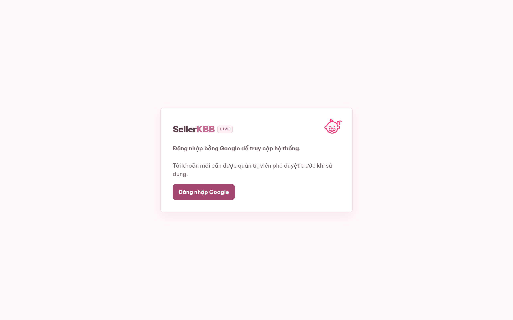

# sellerkbb DESIGN.md

> Auto-generated design system — reverse-engineered via static analysis by skillui.
> Frameworks: None detected
> Colors: 20 · Fonts: 1 · Components: 9
> Icon library: not detected · State: not detected
> Primary theme: light · Dark mode toggle: no · Motion: expressive

## Visual Reference

**Match this design exactly** — study colors, fonts, spacing, and component shapes before writing any UI code.



---

## 1. Visual Theme & Atmosphere

This is a **light-themed** interface with a warm, approachable feel. The light background emphasizes content clarity. Typography uses **Be Vietnam Pro** throughout — a clean, modern choice that maintains consistency. Spacing follows a **4px base grid** (compact density), with scale: 2, 4, 6, 8, 10, 12, 14, 16px. The palette is predominantly monochromatic with **#e7abc7** as the single accent color — used sparingly for interactive elements and emphasis. Motion is expressive — spring physics, layout animations, and staggered reveals are part of the visual language.

---

## 2. Color Palette & Roles

| Token | Hex | Role | Use |
|---|---|---|---|
| background | `#f0faf6` | background | Page background, darkest surface |
| surface | `#ffffff` | surface | Card and panel backgrounds |
| surface-strong | `#fde8f2` | surface | Card and panel backgrounds |
| surface | `#fff9e9` | surface | Card and panel backgrounds |
| text-muted | `#58394a` | text-muted | Captions, placeholders, secondary info |
| border | `#604654` | border | Dividers, card borders, outlines |
| accent | `#e7abc7` | accent | CTAs, links, focus rings, active states |
| danger | `#f8c4dc` | danger | Error states, destructive actions |
| success | `#2f6d50` | success | Success states, positive indicators |
| unknown | `#a65a7b` | unknown | Palette color |
| unknown | `#a34773` | unknown | Palette color |
| muted | `#715665` | unknown | Palette color |
| text | `#422d38` | unknown | Palette color |
| unknown | `#8d4969` | unknown | Palette color |
| unknown | `#cce7dd` | unknown | Palette color |
| muted | `#856d79` | unknown | Palette color |
| unknown | `#7c6070` | unknown | Palette color |
| unknown | `#bfe8d1` | unknown | Palette color |
| unknown | `#8d4356` | unknown | Palette color |
| unknown | `#f8d6de` | unknown | Palette color |

### CSS Variable Tokens

```css
--muted: #856d79;
--accent: #eb8db9;
--accent-strong: #d96ca3;
--accent-soft: #fde4f0;
--muted: #7d7077;
--accent: #d86f9f;
--accent-strong: #c75f90;
--accent-soft: #f8e7ef;
--muted: #88717d;
--accent: #e7a3c0;
--accent-strong: #d77ca5;
--accent-soft: #fdeaf2;
--muted: #75616b;
```


---

## 3. Typography Rules

**Font Stack:**
- **Be Vietnam Pro** — Heading 1, Heading 2, Body, Caption

**Font Sources:**

```css
@font-face {
  font-family: "Be Vietnam Pro";
  src: url("fonts/BeVietnamPro-Bold.ttf") format("truetype");
  font-weight: 700;
}
@font-face {
  font-family: "Be Vietnam Pro";
  src: url("fonts/BeVietnamPro-Regular.ttf") format("truetype");
  font-weight: 400;
}
```

| Role | Font | Size | Weight |
|---|---|---|---|
| Heading 1 | Be Vietnam Pro | 28px | 700 |
| Heading 2 | Be Vietnam Pro | 24px | 700 |
| Body | Be Vietnam Pro | 10.5px | 400 |
| Caption | Be Vietnam Pro | 12px | 400 |

**Typographic Rules:**
- Use **Be Vietnam Pro** for all text — do not mix font families
- Maintain consistent hierarchy: no more than 3-4 font sizes per screen
- Headings use bold (600-700), body uses regular (400)
- Line height: 1.5 for body text, 1.2 for headings
- Use color and opacity for secondary hierarchy, not additional font sizes


---

## 4. Component Stylings

### Navigation (1)

**Navigation** — `html`

### Data Display (3)

**Card** — `html`
- Variants: `open-note`

**Badge** — `html`

**List** — `html`

### Data Input (2)

**Button** — `html`
- Animation: 

**Input** — `html`
- State: :focus, :placeholder

### Overlay (1)

**Modal** — `html`

### Media (2)

**Image** — `html`

**Map/Canvas** — `html`


---

## 5. Layout Principles

- **Base spacing unit:** 4px
- **Spacing scale:** 2, 4, 6, 8, 10, 12, 14, 16, 18, 20, 22, 24
- **Border radius:** 2px, 4px, 6px, 7px, 8px, 9px, 10px, 11px, 12px, 13px, 14px, 15px, 16px, 18px, 999px, inherit
- **Max content width:** 1100px

**Spacing as Meaning:**
| Spacing | Use |
|---|---|
| 4-8px | Tight: related items within a group |
| 12-16px | Medium: between groups |
| 24-32px | Wide: between sections |
| 48px+ | Vast: major section breaks |


---

## 6. Depth & Elevation

### Flat — subtle depth hints

- `0 1px 2px rgba(67,42,54,.025)`
- `inset 0 0 0 1px #e0bdcd`
- `0 0 0 2px rgba(216,111,159,.08)`

### Raised — cards, buttons, interactive elements

- `var(--shadow-md)`
- `var(--shadow-sm)`
- `0 0 0 4px rgba(238,147,189,.12)`

### Floating — dropdowns, popovers, modals

- `0 3px 10px rgba(144,77,111,.04)`
- `0 6px 17px rgba(190,89,140,.09)`
- `0 7px 18px rgba(189,78,132,.15)`

### Overlay — full-screen overlays, top-level dialogs

- `0 10px 22px rgba(189,78,132,.2)`
- `0 24px 70px rgba(100,61,80,.22)`
- `inset 4px 0 0#d56e9e,0 18px 46px rgba(151,88,117,.20),0 5px 14px rgba(126,72,97,.11)`

### Z-Index Scale

`1, 2, 10, 20, 39, 40, 90, 115, 120`


---

## 7. Animation & Motion

This project uses **expressive motion**. Animations are an integral part of the experience.

### CSS Animations

- `@keyframes data-refresh-spin`
- `@keyframes account-modal-in`
- `@keyframes section-enter`
- `@keyframes statusDotPulse`
- `@keyframes sync-spin`
- `@keyframes dialog-enter`

### Animated Components

- **Button**: 

### Motion Guidelines

- Duration: 150-300ms for micro-interactions, 300-500ms for page transitions
- Easing: `ease-out` for enters, `ease-in` for exits
- Always respect `prefers-reduced-motion`


---

## 8. Do's and Don'ts

### Do's

- Use `#e7abc7` for interactive elements (buttons, links, focus rings)
- Use `#f0faf6` as the primary page background
- Use **Be Vietnam Pro** for all UI text
- Follow the **4px** spacing grid for all margins, padding, and gaps
- Use the defined shadow tokens for elevation — see Section 6
- Use border-radius from the scale: 2px, 4px, 6px, 7px, 8px
- Reuse existing components from Section 4 before creating new ones

### Don'ts

- Don't introduce colors outside this palette — extend the design tokens first
- Don't mix font families — use Be Vietnam Pro consistently
- Don't use arbitrary spacing values — stick to multiples of 4px
- Don't create custom box-shadow values outside the system tokens
- Don't use arbitrary border-radius values — pick from the defined scale
- Don't duplicate component patterns — check Section 4 first
- Don't use backdrop-blur or blur effects

### Anti-Patterns (detected from codebase)

- No blur or backdrop-blur effects
- No zebra striping on tables/lists


---

## 9. Responsive Behavior

| Name | Value | Source |
|---|---|---|
| xs | 340px | css |
| xs | 350px | css |
| xs | 360px | css |
| xs | 420px | css |
| xs | 430px | css |
| xs | 480px | css |
| sm | 520px | css |
| md | 700px | css |
| md | 701px | css |
| lg | 900px | css |
| lg | 1000px | css |
| xl | 1050px | css |
| xl | 1100px | css |

**Approach:** Use `@media (min-width: ...)` queries matching the breakpoints above.


---

## 10. Agent Prompt Guide

Use these as starting points when building new UI:

### Build a Card

```
Background: #ffffff
Border: 1px solid #604654
Radius: 12px
Padding: 16px
Font: Be Vietnam Pro
Use shadow tokens from Section 6.
```

### Build a Button

```
Primary: bg #e7abc7, text white
Ghost: bg transparent, border #604654
Padding: 8px 16px
Radius: 12px
Hover: opacity 0.9 or lighter shade
Focus: ring with #e7abc7
```

### Build a Page Layout

```
Background: #f0faf6
Max-width: 1100px, centered
Grid: 4px base
Responsive: mobile-first, breakpoints from Section 9
```

### Build a Stats Card

```
Surface: #ffffff
Label: #58394a (muted, 12px, uppercase)
Value: var(--text-primary) (primary, 24-32px, bold)
Status: use success/warning/danger from Section 2
```

### Build a Form

```
Input bg: #f0faf6
Input border: 1px solid #604654
Focus: border-color #e7abc7
Label: #58394a 12px
Spacing: 16px between fields
Radius: 12px
```

### General Component

```
1. Read DESIGN.md Sections 2-6 for tokens
2. Colors: only from palette
3. Font: Be Vietnam Pro, type scale from Section 3
4. Spacing: 4px grid
5. Components: match patterns from Section 4
6. Elevation: shadow tokens
```
